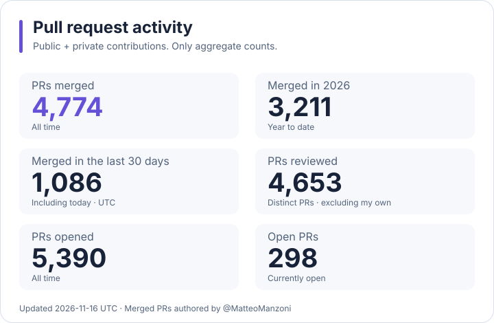

# Hi, I'm Matteo 👋

Building at [Docplanner](https://github.com/Docplanner). I enjoy making infrastructure, automation, and the connected home work better.

## Shipping & reviewing

<picture>
  <source media="(prefers-color-scheme: dark)" srcset="./assets/pr-stats-dark.svg">
  <source media="(prefers-color-scheme: light)" srcset="./assets/pr-stats-light.svg">
  
</picture>

<!-- profile-stats:start -->

Counts, coverage, and definitions · updated 2026-11-16 UTC

| Metric | Count |
| :--- | ---: |
| PRs merged | 4,774 |
| Merged in 2026 | 3,211 |
| Merged in the last 30 days | 1,086 |
| PRs reviewed | 4,653 |
| PRs opened | 5,390 |
| Open PRs | 298 |

These totals combine public repositories and private repositories accessible to the statistics credential at refresh time. Only aggregate counts are published.

Merged and opened PRs are authored by me. Reviewed PRs count distinct pull requests I reviewed, excluding my own; multiple reviews on the same PR count once. The 30-day window covers 2026-10-18 through 2026-11-16, inclusive, using UTC dates.

Source: [GitHub pull request search](https://docs.github.com/en/search-github/searching-on-github/searching-issues-and-pull-requests). [How the refresh works](./docs/profile-stats.md).

<!-- profile-stats:end -->

## Things I build

| Project | What it does |
| :--- | :--- |
| [REHAU Nea Smart 2.0](https://github.com/MatteoManzoni/rehau-neasmart2.0-integration-ha) | Bring REHAU climate control into Home Assistant. |
| [Helty ventilation](https://github.com/MatteoManzoni/helty-cmv-integration-ha) | Integrate Helty heat recovery ventilation with Home Assistant. |
| [go-mikroticata](https://github.com/MatteoManzoni/go-mikroticata) | Connect Suricata to MikroTik using Go, Redis, and the RouterOS REST API. |
| [dotfiles](https://github.com/MatteoManzoni/dotfiles) | The scripts and configuration behind my everyday setup. |

**Working with:** Python · Go · Shell · Home Assistant · MikroTik

