# Hi, I'm Matteo 👋

Building at [Docplanner](https://github.com/Docplanner). I enjoy making infrastructure, automation, and the connected home work better.

## GitHub

<!-- profile-stats:start -->
<!-- Updated 2026-11-17 UTC -->

<!-- profile-stats:end -->

## Things I build

| Project | What it does |
| :--- | :--- |
| [REHAU Nea Smart 2.0](https://github.com/MatteoManzoni/rehau-neasmart2.0-integration-ha) | Bring REHAU climate control into Home Assistant. |
| [Helty ventilation](https://github.com/MatteoManzoni/helty-cmv-integration-ha) | Integrate Helty heat recovery ventilation with Home Assistant. |
| [go-mikroticata](https://github.com/MatteoManzoni/go-mikroticata) | Connect Suricata to MikroTik using Go, Redis, and the RouterOS REST API. |
| [dotfiles](https://github.com/MatteoManzoni/dotfiles) | The scripts and configuration behind my everyday setup. |

**Working with:** Python · Go · Shell · Home Assistant · MikroTik

